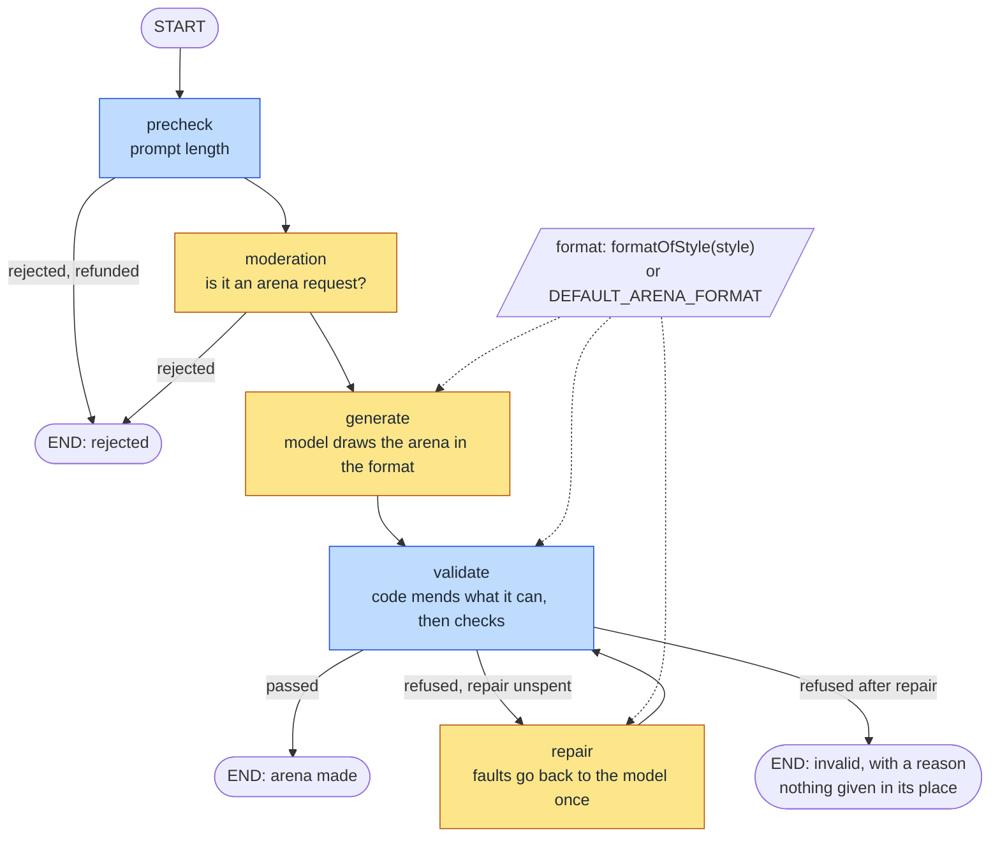

# Arena graph

Drawn from `ai/src/pipeline/arena/graph/CreateArenaGraph.ts` and `routing/RouteAfterValidate.ts`.

Node colours: **model calls** are amber and **code** is blue. The shared design of both graphs is in [the index](README.md#how-the-graphs-are-put-together).

- **Model calls:** 2 on a clean run and 3 at most.
- The same format is used for the first try and for the repair. Only a request turned away before any model call is refunded.
