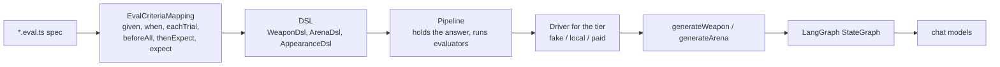

# The layers a spec talks through

A spec may import only `EvalCriteriaMapping` (lint enforces this). The DSL and the Pipeline match acceptance-tests' `GunsmithDsl` over
`GunsmithPlaywright`: the DSL turns a failure into one sentence, and the Pipeline is the only class that knows how to reach the system
under test.

For the whole run, from the tier to the results file, see [how an eval run works](eval-run.md).
