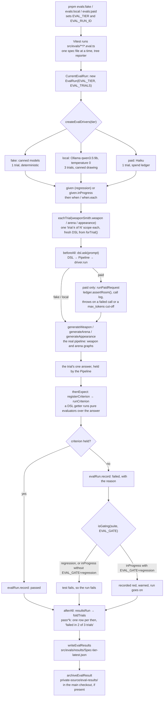

# How an eval run works

Drawn from `ai/package.json`, `ai/vitest.evals.config.ts`, `ai/src/evals/eval-criteria-mapping/` and `ai/src/evals/dsl/`.

- **Tiers measure different things.** The fake tier proves the wiring, the local tier is a free loop that cannot be fully repeated, and
  the paid tier is the real model. Scores do not carry over from one tier to another. `EVAL_TRIALS` overrides the tier's trial count.
- **A trial runs its request once.** The `beforeAll` asks, and every `then` in that trial reads the same answer. A criterion holds only
  if it held in every trial.
- **The evaluators are pure code:** `schemaValid`, `withinCaps`, `nameHygiene`, `drawnWhenCreated`, `noPromptLeak`, `nodePath` and the
  arena and drawing ones beside them under `ai/src/evals/dsl/<domain>/pipeline/evaluators/`. No model judges an answer yet.
- The arena and drawing drivers also keep what was made as contact sheets (`*-latest.html`) next to the JSON.

The [layers a spec talks through](eval-layers.md) show the same run from the spec's side.
