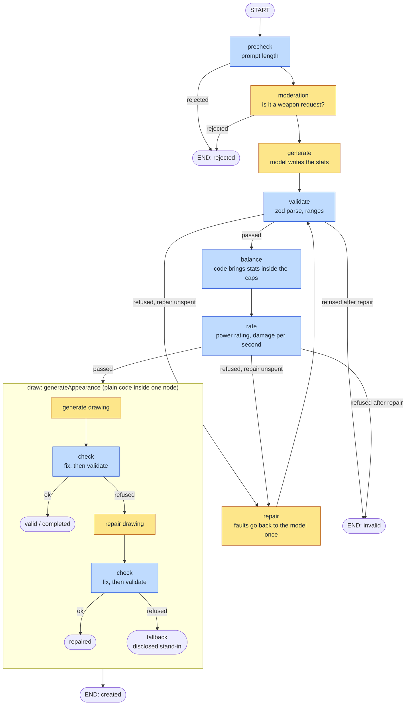

# Weapon graph

Drawn from `ai/src/pipeline/weapon/graph/CreateWeaponGraph.ts`, its `routing/` folder and `ai/src/pipeline/appearance/GenerateAppearance.ts`.

Node colours: **model calls** are amber and **code** is blue. The shared design of both graphs is in [the index](README.md#how-the-graphs-are-put-together).

- **Model calls:** 3 on a clean run (moderation, stats, drawing) and 5 at most (one repair for the stats, one for the drawing).
- A drawing that cannot be made still leaves a weapon that was created. The drawing reads only the player's words, never the stats, and
  adds its steps to `nodes` with an `appearance.` prefix.
- A rejected or invalid request draws nothing.
