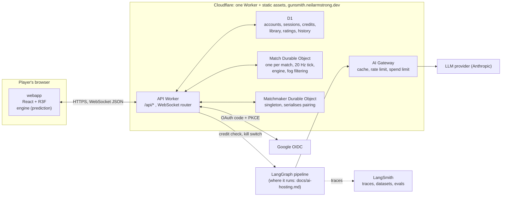

# Architecture

How gunsmith is put together, and where it deliberately differs from janggi. Janggi is the structural model
(`/Users/neilarmstrong/Development/Personal/janggi`, especially `AGENTS.md` and `docs/online-play.md`).

## Packages

pnpm workspace, `@gunsmith/*`, no build step for `shared/` and `engine/` (consumed as TypeScript), exact-pinned `catalog:`.

| Package | Contains | May import |
| ------- | -------- | ---------- |
| `shared/` | Vocabulary, wire types, the weapon and arena zod schemas, fixtures, the credit config, base tool config | nothing |
| `engine/` | Deterministic simulation: fixed timestep, seeded RNG, movement, collision, projectiles, visibility, power rating and caps, arena validator, output moderation | shared |
| `ai/` | LangChain / LangGraph pipeline, judges, token pre-check, evals (separate vitest config) | shared, engine |
| `webapp/` | Vite, React 19, Redux Toolkit, Tailwind v4, react-three-fiber | shared, engine |
| `api/` | The Worker: auth, credits, library, ratings, the `Match` and `Matchmaker` Durable Objects, kill switch | shared, engine (and `ai/` only if hosting decision says so) |
| `acceptance-tests/` | Playwright DSL and specs | shared |
| `infra/` | Alchemy: Worker with static assets, D1, Durable Object namespaces, rate limiters | itself |

Boundaries are enforced by ESLint (`restrictedImports` in `shared/config/eslint.base.js`) exactly as in janggi.

## System view

The engine is compiled into the browser (prediction), the `Match` Durable Object (authority) and `ai/` (rating and
validation). It is shared code, not a service.

## Where this differs from janggi, on purpose

| Janggi | Gunsmith | Why |
| ------ | -------- | --- |
| Site on GitHub Pages, API on a sibling host, `SameSite=Lax` cookie across hosts | One Worker with static assets; `/api/*` runs the Worker first | Everything on Cloudflare; same-origin cookie; no CORS |
| Turn-based `GameRoom`; actions applied as they arrive | Server-authoritative fixed tick (20 Hz), input validation, client prediction and interpolation | A real-time shooter |
| Hibernating Durable Object, nothing in memory | A ticking object stays awake for a match | A tick loop cannot hibernate; measured by the free-plan spike |
| Redux for nearly all state | Redux for UI, lobby, library, credits only; the running simulation lives outside Redux, read in `useFrame` | 60 fps state must not go through a reducer |
| Rules visible to both clients | Fog enforced on the server; snapshots omit hidden opponents; sounds carry only a quantised direction | Otherwise fog is cosmetic and trivially cheated |
| "Never enable Workers Paid" | Try the free plan first, accept Workers Paid with budgets and a kill switch if the spike says so | A tick loop plus AI |
| Component tests via DOM | The canvas is not in the DOM; the DSL reads a tiny read-only state hook | react-three-fiber |
| English and Korean `Messages` layer | English only, hard-coded | A far less text-heavy game |
| PWA, service worker, cross-origin isolation, push, bot engine | None | Not needed |
| Opt-in Google sign-in for sync only | Opt-in Google sign-in for credits and the library; guests can play | The AI costs money |
| Plain imperative commit messages | Conventional Commits | The user's global rule |

## What is copied from janggi unchanged

The `AGENTS.md` code-style and process rules; the ATDD layers (`src/tests` → mapping → `dsl` → `shared`) and `withDslOnly`;
`FakeApi` for specs; plain-function Worker with a thin runtime edge and in-memory fakes with a contract suite shared with
the D1 implementation; `oauth4webapi` with PKCE, `openid` scope only, opaque hashed session tokens, no email stored;
Drizzle generates and Wrangler applies migrations; Alchemy 0.x with pinned names and `adopt: true`; the catalog and
7-day release-age policy; privacy-preserving closed-event logging (`logApiEvent`); `MANUAL-SETUP-STEPS.md`; sharded CI
with a post-deploy run against production.

## Hosting and DNS

`gunsmith.neilarmstrong.dev`, DNS at Cloudflare. One label below the registrable domain (a deeper name has no free
certificate). The custom domain is attached by hand (`MANUAL-SETUP-STEPS.md`). Environments: local and `prod` only.

## Open architecture questions

- Where the LangGraph pipeline runs (`docs/ai-hosting.md`), which decides whether `api/` imports `ai/`.
- Free plan or Workers Paid (`docs/cost-and-budget.md`, the spike).
