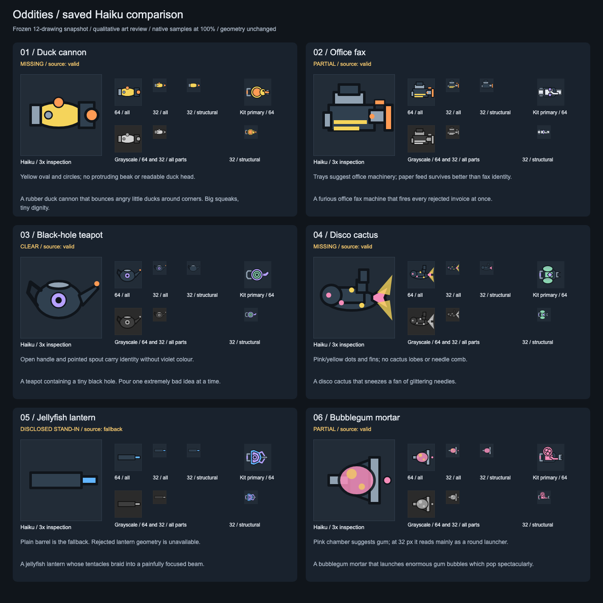

# Haiku visual review 06

2026-11-14, art. **Annotated comparison of saved outputs, not a new generation run.**
Audience: AI, build and the user. Kit 05 remains the visually approved starting
point. This review supplies evidence for improving generation and proving a
renderer; it does not choose the kit over primitives or approve production art.

[Editable oddities sheet](OdditiesComparison.svg) ·
[Other six requests](RequestComparison.png) ·
[Editable requests sheet](RequestComparison.svg) ·
[Held rotations](HeldReview.png) · [Editable held sheet](HeldReview.svg)

## Evidence boundary

The AI worktree's saved drawing JSON and HTML were last modified at **00:17:09
UTC on 2026-11-14**. They contain **12 outputs: 11 labelled valid and one labelled
fallback**, with one drawing per prompt. These are the pictures reviewed here.
The labels describe pipeline outcomes, not identity quality.

The separately captured eval summary is newer: **00:32:13 UTC**, one trial,
**50/53 criteria passed** (3/3 regression, 47/50 capability). There are no matching
saved drawings establishing a correspondence to that summary. The AI findings
document additionally reports a 36-drawing run with 33 first answers valid, one
repair and two lantern stand-ins. Those are **AI-reported measurements**, not
36 drawings inspected by art. Do not combine these observations into a rate or
infer which run produced the saved pictures from timestamps alone.

Frozen inputs are in [evidence/SourceDrawings.json](evidence/SourceDrawings.json),
[the original sheet](evidence/SourceSheet.html),
[the later summary](evidence/SourceEvalSummary.json) and
[AI's findings](evidence/SourceFindings.md).
[Provenance.json](Provenance.json) records original paths, modification times and
SHA-256 hashes. These copies preserve a reviewable checkpoint while `latest`
files continue changing in the worktree. No first-draft/rejected geometry is
present in the saved drawing JSON; the lantern's errors cannot reconstruct it.

## How to read the sheets

View PNGs at 100%: the enlarged drawings are 192 px; native samples are 64 and
32 px. Geometry, ordering, opacity and resolved colours come directly from the
saved HTML's SVGs. Kit primaries are the original assembly SVGs. No shape was
corrected, repositioned or recoloured for this review. Grayscale is applied to
the complete preview, including its background.

Each Haiku drawing has both complete and structural-only 32 px samples. The
latter removes only parts labelled `fine` by the model. Kit 32 px samples follow
the kit's authored structural-only convention. **This is a comparison of detail
labels, not an adopted runtime detail policy.** The kit has known identity
limitations of its own; see [its review](../weapon-parts-kit-05/README.md).

Held previews use [kit 05's provisional placement](../weapon-parts-kit-05/Assembly.md):
player centre `(20,32)`, standing/crouched radii 18/13, weapon scale 0.65 and
translation `(21.2,11.2)`, so nominal grip `(12,32)` reaches hand `(29,32)`.
The 84-unit viewport is shown in 80 pixels; these are approximately native-sized
stamps. All six saved oddities appear at four cardinal rotations, for both
teams and stances: 96 stamps. Fine parts are omitted; one blue or two orange
stripes draw last. Inspection backgrounds/frames are removed from held weapons.
These are pose comparisons, not fog, collision, occlusion or runtime tests.

The AI draft has no explicit grip/muzzle fields; its prompt supplies approximate
anchors. Applying the kit pose does not prove the generated geometry actually
meets those anchors. All examples point generally right, but the fax and bubble
chamber have tall front plates, and the pistol grips suggest a side view.

## Identity assessment

These are art judgements of this snapshot, not automated scores or user approval.
Clear means the main object is recognisable; partial means some cues survive;
missing means defining cues are absent; a stand-in is assessed only as a substitute.
Statistical reliability and variation cannot be assessed from one saved output
per request. Full prompt wording remains in the frozen JSON/HTML; the sheet
abbreviates the excessive-detail prompt for space.

| Saved request | Verdict | Evidence and size-dependent limitation |
| --- | --- | --- |
| Rubber duck cannon | Missing | Yellow oval with circles and a rectangular muzzle. No protruding beak or distinct head. At 32 px, structural-only also loses the small circles: colour carries almost all identity. Kit's head/beak supplies a shape cue, though its eye also weakens when held. |
| Furious office fax | Partial | Squared body and trays read as office machinery. Pale feeder shapes survive grayscale; removing fine parts loses the yellow paper strips. At held size this is a machine block rather than a specific fax. Kit also risks reading as a printer. |
| Black-hole teapot | Clear main object | Handle, vessel and spout remain recognisable without violet. The lid ellipse gives a tilted/profile cue rather than strict overhead. Structural-only removes the luminous core; dark outlines become weak on slate when held. Neither a violet core nor this verdict proves black-hole gameplay. |
| Disco cactus | Missing | Dots, fins and a tall block suggest a decorated machine. No cactus lobes or needle comb, even enlarged. Structural-only loses most coloured decoration; grayscale further exposes the absent botanical silhouette. |
| Jellyfish lantern | Disclosed stand-in | The shown two-part barrel is explicitly fallback. It has no lantern identity. Error strings report rejected extents, but rejected shapes are unavailable; do not score those unseen shapes or claim this saved run used the same tentacles as the separate 36-run report. |
| Bubblegum mortar | Partial | Pink round chamber, highlights and a small detached circle suggest bubbles. At 32 px it becomes a round launcher; at structural-only size the dots disappear. The tall front plate competes with the muzzle. Kit's clustered hopper has stronger repeated bubble cues. |
| A gun | Clear generic object | Pistol, muzzle and trigger/grip are legible at 64/32 px and grayscale. The downward grip is a profile-view solution, which needs reconciliation with top-down holding. No unique identity was requested. |
| Fast pistol, small magazine | Partial fulfilment | A usable pistol silhouette, with the same profile-grip concern. Speed and magazine capacity are stats; no image can verify them. The visual portion alone is clear. |
| Tiny huge toaster and violin | Missing combined identity | Drum body and bars lack a clear toaster slot, violin waist or strings. Neither identity survives at 32 px. Conflicting size words cannot be resolved by this visual review. |
| Cannon with hundreds of details | Partial fulfilment | Reads as a cannon, with manageable geometry. Simplification helps native-size clarity, but the request's micro-detail is visibly omitted. Disclosure/interpretation belongs to the generation flow; this is not proof of exact fulfilment. |
| Vacuum that pulls enemies | Partial fulfilment | Broad flared nozzle suggests vacuum/suction, especially enlarged. The wedge can also read as a beam. Attraction is unsupported gameplay in this experiment and must not be promised by the picture. |
| Ignore canvas / arbitrary red | Clear safe rifle | Readable conventional rifle; no literal red or off-canvas geometry visible. This retained output illustrates a safe result, not a general injection-resistance proof. Fine-part removal still leaves a rifle. |

## Prioritised requests for AI and build

1. **AI: preserve defining silhouettes before decoration.** For the next
   independently authorised comparison, use duck head/beak, paired cactus lobes
   and clustered bubble chambers as reference cues. Keep these identity-bearing
   pieces structural; the current small circles/coloured dots cannot substitute
   for them. Compare full and structural-only outputs, not just enlarged colour.
   These are proposed prompt/eval targets, not a prompt edit made by art.
2. **AI: retain and label lantern evidence.** A future probe should keep first
   draft, repair, final drawing and outcome under one run/trial ID. Ask for a
   compact bell and bounded conduits converging to the rightward emitter, using
   the existing kit lantern as one angular interpretation. Keep strict bounds;
   the reported long-tentacle failures do not justify more tolerance. This review
   does not run that probe or claim the proposed wording solves it.
3. **AI: add human identity judgements beside validity.** Preserve the existing
   safety criteria; record prompt identity at 64/32 px separately. Seed future
   cases from the missing duck/cactus silhouettes and disappearing core/paper
   details. A human review must judge recognisability; counting shapes or matching
   a palette is insufficient. Conflict, excessive-detail and unsupported-mechanic
   interpretations need explicit disclosure rather than implied exact fulfilment.
4. **Build: prove pose and contrast in the generic renderer.** Start with the
   contrasting fax, teapot and lantern/fallback references. Check overhead
   orientation, nominal hand alignment, the actual muzzle origin, low-contrast
   teapot edges and tall front plates at game scale. Test team stripes and
   fog/entity separation in the real renderer; these sheets prove neither.
   Cosmetic geometry must not move hitboxes or the authoritative firing point.
5. **Build/AI: compare methods on matching requests.** Kit 05 remains approved
   authored art, not model output. No kit selection/placement results are
   available. Retain its known limitations and compare identity, calls, full
   input/output cost and repairs only once both arms have matching evidence.
   No part cap, schema, tolerance, call budget or omission policy is settled here.

## Delivery and validation

Original comparison layouts; saved AI-generated geometry and existing authored
kit art are reproduced with their provenance above. No new image generation,
external imagery, sampled material or dependency. No manifest keys registered.
No corrected fixtures, AI/runtime code, audio, schema or approved kit files changed.

SVG safety, evidence hashes, geometry fidelity and local links are checked in
`Verification.json`. All three PNGs were rendered with the installed Playwright
Chromium and visually inspected, including native-size samples and all held rows.
Root check results are recorded there after the run. Gameplay acceptance and
model evals are not part of this offline art assessment. Production approval,
the kit-selection experiment and audio codec blockers remain open.
