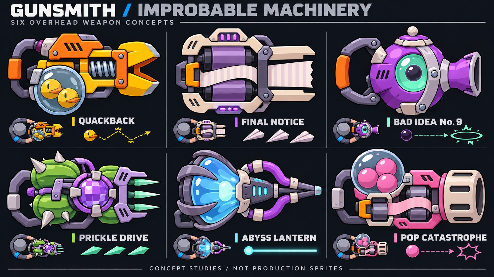

# Improbable machinery: six weapon concepts

2026-11-12, art. User request: generate concepts from the new chunky cartoon sci-fi machinery direction.

Extends [direction study 02](overhead-machinery-02.md) to all six original prompt families. The new image uses that
original study as its visual reference. No franchise artwork was supplied to the model. Provenance: OpenAI image
generation; original concepts for Gunsmith. This is a raster exploration, not production art or parsed weapon JSON.

## Construction rules for an editable translation

| Concept | Primary / secondary masses | Reusable construction relationships | Proposed gameplay |
| --- | --- | --- | --- |
| Quackback | Split beak muzzle / offset capsule hopper | Hopper feeds exposed spring breech; forked shroud points along aim; rear brace stays open | Bounded ricochet |
| Final Notice | Broad paper rails / transverse rollers | Pale ribbon crosses dark rollers toward the open front; casing flanks preserve an open paper path | Paper-shaped shotgun pellets |
| Bad Idea No. 9 | Round pressure vessel / tapered spout | Offset retaining band frames a mint window; rear crescent brace and front collar contrast with circular shell | Explosive orb |
| Prickle Drive | Staggered ribbed pods / faceted central crown | Large fins break the outer contour; side pods feed a forward needle comb; underframe leaves gaps | Needle shotgun |
| Abyss Lantern | Wide bell / narrow emitter | Cage petals surround core; two separated conduits converge toward the front, preserving a wide-to-narrow footprint | Focused beam |
| Pop Catastrophe | Offset round hopper / oversized muzzle collar | Gum ribbon routes through exposed rollers; opaque shell, transparent window and metal frame use separate value groups | Explosive bubble |

Each construction has one dominant mass and one contrasting mechanism, rather than a uniform series of tiny shapes.
The chamber, brace, shroud, roller, conduit and window are reusable subjects; never make renderer branches keyed to
these six names. Implement a primitive composition first, then consider bounded material/window presets only where
it exposes a real need. Retain the fixed grip/aim/muzzle contract and the proposed structural/fine detail tiers.

The image's hopper contents, visible barrels, fins and crown are cosmetic. They do not determine ammo, pellet count,
independent firing origins, poison, gravity or sticky terrain. Build/AI still own those rules. Large silhouettes do
not change collision, concealment or the player's vision cone. The three original prompts and new three retain the
mechanics exclusions in [the oddities brief](prompt-built-oddities.md).

## Review notes and next step

The six share painted shells, graphite recesses and metal braces while differing in body layout. Prickle Drive's
lobed footprint and Abyss Lantern's bell-to-emitter taper offer especially clear alternatives to the circular hoppers.
The held thumbnails provide composition context, not measured 64/32 px proof. Some rounded housings and muzzle facets
still suggest an oblique view; editable translation should flatten those into strict overhead footprints and controlled
shading bands. Preserve the mechanisms without carrying every highlight, bolt or small reflection into gameplay scale.

Keep the earlier twelve vector/JSON fixtures as first-pass work. Next translate this stronger shape language into
editable compositions and measure actual-size held readability before approving grammar or final sprites. No new
schema, runtime, asset key, dependency, audio or balance change is included.

Verification: PNG header/dimensions and local links pass; `git diff --check` passes. Selected workspace checks
(shared, engine, webapp, AI and acceptance DSL) exit 0, covering lint, formatting, strict typecheck and unit tests.
Unchanged audio was not rendered again; its full workspace checks passed earlier in the session. No gameplay
acceptance or model evals run for this concept-only delivery.
