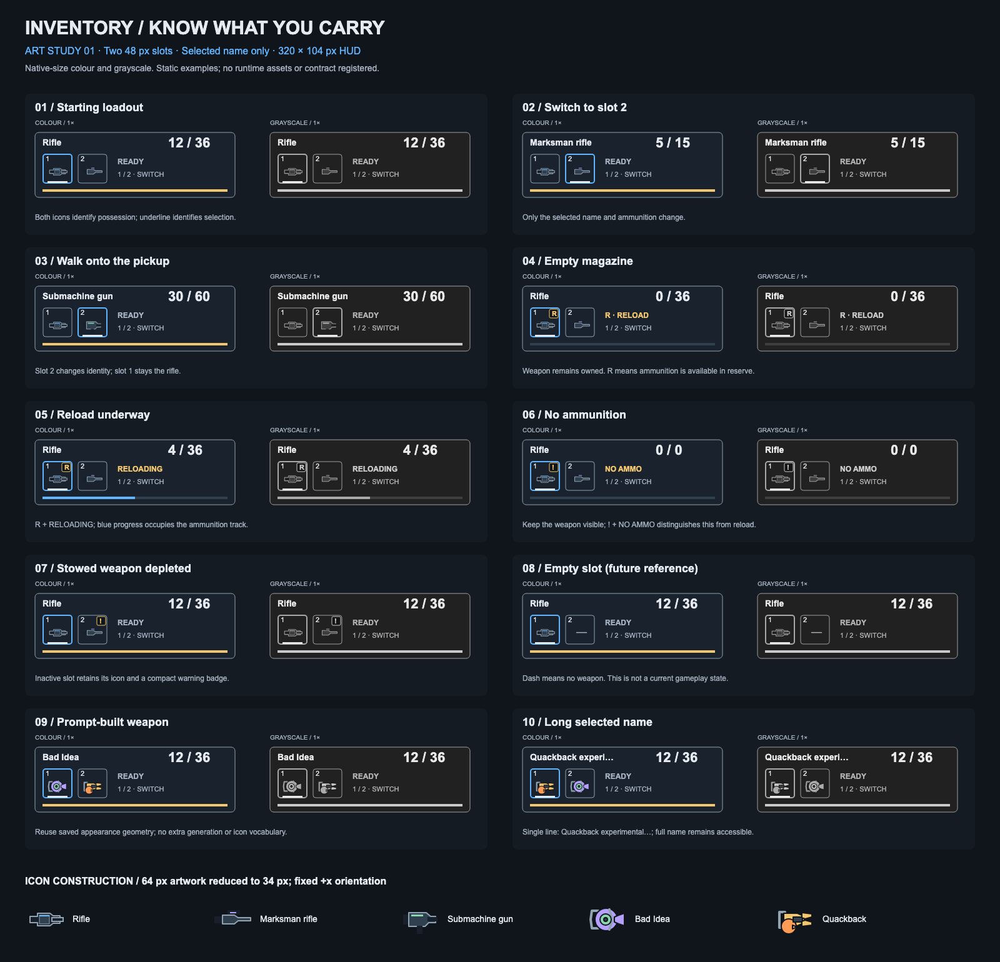

# Inventory display: know what you carry

Art/research session 1, 2026-11-17. User chose **two compact icons and only the
selected weapon's name**. User visually approved the rendered study: “looks good!”
Runtime integration belongs to build; these are static, original vector studies.

[Editable SVG](Review.svg) · [1280 × 720 context](context/Arena1280.png) ·
[1920 × 1080 context](context/Arena1920.png) ·
[1280 editable SVG](context/Arena1280.svg) ·
[1920 editable SVG](context/Arena1920.svg)

## Recommendation

Keep both carried weapons visible in numbered 48 × 48 px slots. Use the selected
weapon's name and rounds/reserve above them, with status beside the slots. One
320 × 104 px panel sits 16 px from the bottom and left, below health with an 8 px
gap. Its footprint stays fixed at both desktop viewport sizes. The panel covers
3.61% of a 1280 × 720 viewport, or 1.60% at 1920 × 1080; that measures screen area,
not lost visibility or gameplay impact. Context sheets are illustrative arena
composites, not screenshots, playable layouts or demonstrations of height/fog rules.

- **Possession:** the actual weapon silhouette occupies the slot, selected or
  stowed. A blue outline identifies selection; the pale underline and heavier
  border preserve that distinction in grayscale. Slot numbers match keys 1 and 2.
- **Name:** show only the selected name, 14 px bold, on one line in a fixed-width
  area, with ellipsis on overflow. Never shrink type to fit. Keep the full name
  in accessible DOM text. Do not depend on hover: the HUD passes pointer input
  through to aiming. Names are escaped text, never markup.
- **Ammo:** show the selected weapon's exact rounds/reserve, 22 px bold. The quiet
  bottom track shows loaded fraction, and becomes reload progress during reload.
  This continuous track is a proposal to bound the current magazine-segment
  layout: a 30-round pickup must not widen the HUD. Numbers remain authoritative.
- **Icons:** fixed right-facing orientation, preserving the complete silhouette
  with padding. The 64 × 64 sources are reduced to about 34 px within the slots;
  never rotate them with aim. Keep state badges outside the silhouette's main area.
  Colour is decorative identity support, not the sole way to distinguish weapons.

[Selected-slot quickbars in Epic's Lyra documentation](https://dev.epicgames.com/documentation/en-us/unreal-engine/lyra-inventory-and-equipment-in-unreal-engine)
provide a useful separation of item display information from ammunition state.
[Xbox Accessibility Guideline 103](https://learn.microsoft.com/en-us/xbox/accessibility/xbox-accessibility-guidelines/103)
recommends reinforcing colour with text and symbols. This study applies those
principles; its dimensions and visual choices are original recommendations, not
measured player-performance results or a claim of accessibility compliance.

## State language

Selection is independent of ammunition status. Keep its underline even when the
selected weapon cannot fire. These rows are presentation rules, not new engine
states or an exported enum.

| Condition | Slot treatment | Selected status |
| --- | --- | --- |
| Rounds remain, even with zero reserve | Weapon icon | READY |
| No rounds, reserve remains | Weapon icon + R badge | R · RELOAD |
| Reload underway, with any remaining rounds | Weapon icon + R badge | RELOADING; progress replaces loaded fraction |
| No rounds and no reserve | Weapon icon + ! badge | NO AMMO |
| Stowed weapon needs reload / has no ammo | Keep icon + R / ! badge | Selected weapon's status is unchanged |
| No weapon in a slot | Dash, number and quiet border | No ammunition claim for that slot |

Reload status takes precedence while reloading. A weapon with no ammunition
remains owned and selectable by the existing rules. Empty slots are future visual
references only: both current starting slots are occupied. Only the equipped
weapon reloads, and switching or taking the pickup cancels that reload. Do not
show reload progress continuing on a stowed weapon or transfer it to the new one.

## Weapon artwork and prompt-built identities

| Study source | Identity cue |
| --- | --- |
| [Rifle](weapons/rifle/Icon.svg) | Existing default silhouette: broad receiver and short barrel |
| [Marksman rifle](weapons/marksman-rifle/Icon.svg) | New study: long barrel, slim body and raised optic |
| [Submachine gun](weapons/submachine-gun/Icon.svg) | New study: short body and projecting magazine |

The rifle reuses the build-reference weapon layer. The other two drawings are
art proposals, not evidence that runtime already draws those weapons. Reuse these
identities for future held/pickup artwork when build adopts them.

For prompt-built weapons, render a thumbnail from the **same validated appearance**
as the held weapon. Cache it by stable visual identity/revision, fit the bounded
64-unit drawing into the icon area without cropping, and omit projectile, impact
and animation effects. Do not infer identity from stats or use an icon keyed only
by slot number. Do not add a model call or restart the shelved kit-generation probe.

Cards 9–10 reuse the body primitives of saved
[Bad Idea and Quackback studies](../simple-machinery-04/README.md), not newly
sampled model outputs. These examples demonstrate varied shapes, not arbitrary
prompt recognition. If appearance is unavailable, retain an occupied-slot neutral
weapon fallback and the available name; never render the empty-slot dash. Build/AI
must preserve existing fallback disclosure when adopting the real renderer.

## Build handover: minimum data and acceptance

Current references inspected: AmmoHud, SelectAmmoReadout, SnapshotOf,
WeaponSnapshot, StartingLoadout, SwitchWeapon, WithPickedUpWeapon and the weapon
constants. Runtime shows selected-slot ammunition only. Engine weapons have stats
but no display name or stable visual identity. Reference `ui-slot-1`/`ui-slot-2`
artwork is not installed in the runtime HUD.

Build needs a deliberate identity path from a weapon definition through the
carried weapon and pickup into presentation: stable identity, display name and a
trusted icon/appearance reference. Never identify a weapon by comparing its stats.
For each local-player slot, presentation also needs rounds/reserve and occupancy;
selection and reload derive from the existing world. Use a slow Zustand selector,
keeping the game store's keys unchanged. Keep animation out of per-frame React
state and preserve the HUD's pointer pass-through.

**Proposed state-hook addition, not a frozen interface:** a small local-player
inventory summary with slot, weapon identity/name and ammunition; absent weapon
metadata means an unoccupied slot. Preserve the existing selected `weapon`
snapshot for its consumers. Report selection/reload using existing values rather
than introducing contradictory state. Icon identity can be an opaque trusted key;
full artwork, arbitrary URLs, opponent inventory and per-frame progress do not
belong in the hook. The DOM must expose readable full names and status for both
slots so browser specs can assert actual output. Build agrees the exact type and
adds it test-first when consumed; art changes no schema or manifest key.

Suggested acceptance scenarios for build, written before runtime changes:

1. A fresh round shows rifle and marksman rifle, with slot 1 selected and its
   name/ammo. Switching changes selection/name/ammo while retaining both identities.
2. Fire, switch away and back: each weapon retains its ammunition and identity.
3. In seeded sparring, walk onto the pickup (existing seed 8): slot 2 becomes the
   submachine gun and is selected, with 30/60; slot 1 remains unchanged.
4. Run a magazine dry with reserve, start/finish reload, then exhaust all ammo:
   distinguish RELOAD, RELOADING and NO AMMO without removing the weapon.
5. Switch during reload, or take a pickup: reload feedback cancels, without
   changing ammunition as though the interrupted reload had completed.
6. A new round restores starting identities/ammo; long names cannot overlap ammo
   or widen the panel. A missing thumbnail still looks occupied.
7. Aim/fire through the noninteractive HUD at both desktop sizes; round overlays
   keep ordinary button behaviour. No hidden opponent data influences the display.

Use the existing switching, reloading and pickup DSLs. Assert visible DOM by
role/label/test ID and compare with the read-only hook, using web-first assertions.
Mutation-prove inherited coverage (wrong slot identity, missed pickup update,
stale reload badge, omitted underline, HUD intercepting input). Empty-slot and
prompt-built examples need runtime scenarios only when those capabilities exist;
do not add game mechanics or a state-writing test hook to exercise this art.

## Verification

Rendered with installed Chromium at 1× and inspected in colour/grayscale. The
native-size sheet covers ten examples, including combined selected/reload/empty
states, stowed depletion, empty slot, saved prompt appearances and a long name.
Both context SVGs remain editable beside their PNGs. Sources are self-contained:
no scripts, event handlers, external images or fonts. Authoring/rendering tools
were temporary; shipped SVGs are the editable sources. No dependency, paid call,
audio change or runtime code was needed.

Static validation passes: six SVGs parse with an allowed-element check and no
external resources; three PNGs match their SVG dimensions; local brief/art-index
links resolve; all ten state examples are present. `git diff --check` passes.
Standards review followed root `AGENTS.md` and the art ownership/direction brief:
listed the added folders and checked reference counts with grep. Only the brief
and review sheet sit at the study root; context composites and weapon sources
live beneath their subjects. No runtime helpers or types were introduced.
Existing artwork/audio remains unchanged except the intended art-index link.

Final `pnpm checks` exited 0 outside the sandbox: repository checks, lint,
formatting, strict typechecks and unit suites all pass (52 shared, 842 engine,
421 AI, 270 webapp, 270 audio; one slow audio render skipped). The initial sandbox
run failed only because ServeFolder could not bind 127.0.0.1 (`EPERM`); the
unsandboxed rerun passed. SVG rendering likewise required Chromium outside the
sandbox.
Runtime acceptance and model evals were not run for this static art delivery;
future integration scenarios above are a build handover, not passing tests.
