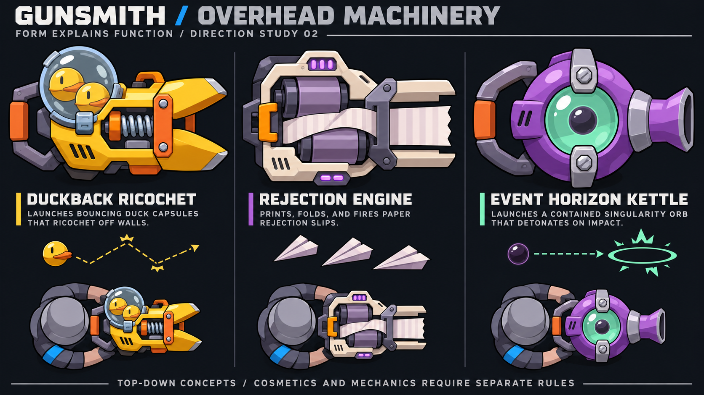

# Overhead machinery: direction study 02

User feedback, 2026-11-12: the first twelve vectors are a start. Use Ratchet & Clank's weapons as inspiration,
adapted to Gunsmith and a 2D overhead perspective. This sheet explores that feedback with three original machines;
it does not replace all twelve editable fixtures or freeze the production art style.

[Six-weapon extension: improbable machinery 03](improbable-machinery-03.md) applies this direction across all prompt families.

## References and interpretation

[PlayStation's official arsenal overview](https://blog.playstation.com/2023/07/26/ratchet-clank-rift-apart-is-out-now-on-pc-what-to-expect/)
identifies explosive Shatterbombs, beam-firing Negatron Colliders and bouncing Ricochet projectiles.
[Lemon Sky's production portfolio](https://lemonsky.artstation.com/projects/2Bvo2v) credits its concept/modelling work
for Insomniac. [Negatron concept-art reference](https://www.creativeuncut.com/gallery-41/rcra-negatron-collider-and-large-negatron-collider.html)
was also located in image search; direct full-resolution retrieval was blocked. No reference artwork was copied into the repo.

The following are art's proposed design principles, not claims about Insomniac's internal production rules:

- Make each weapon an inventive machine with one exaggerated working feature: big reservoir, roller chamber or muzzle.
- Use a large primary mass, a contrasting secondary mechanism and a small brace/latch. Avoid equally weighted primitives.
- Show what the device does through its assembly: rollers feed paper; a spring chamber loads ricocheting capsules;
  retaining bands contain an unstable orb. Decorations support that story rather than carrying the whole identity.
- Use asymmetry, tapered shells, split shrouds and open frame gaps to separate silhouettes at gameplay size.
- Give painted shells, dark recesses, metal bands and energy windows different value groups. Keep colour restrained
  enough to retain the blue/orange team stripes and the arena's danger markings.
- For 2D, draw the overhead footprint first. Use a few facet/shadow bands to suggest thickness within it, without
  tilting the whole weapon into a side or isometric view. A useful footprint survives removal of all shading.

## Three applications

| Design | Main identity | Mechanical assembly | Proposed behaviour boundary |
| --- | --- | --- | --- |
| Duckback Ricochet | Oversized split beak launch shroud | Offset capsule reservoir, spring breech, bumper brace | Bounded ricochet; no wall penetration |
| Rejection Engine | Heavy paper-ejection rails | Twin rollers, routed paper ribbon, latch and shell | Paper-shaped shotgun pellets; no readable invoices or blinding |
| Event Horizon Kettle | Large containment vessel and flared spout | Open rear crescent brace, retaining bands, orb window | Explosive projectile; no gravitational attraction |

The generated image's captions describe intended ideas, not available engine mechanics. Its held views use much larger,
more substantial weapons than the first sheet; actual held scale and maximum extent must be measured against aim,
team-stripe clearance and world collision rules. The player/hand drawing is contextual and not a new player-sprite design.

## How this can remain JSON-driven

Keep the earlier primitive vocabulary as the low-level drawing language. Change the composition guidance before adding
new schema types: stronger mass ratios, substantial foreground muzzle shapes, asymmetrical chambers, and open space.
Do not implement named Duckback/Rejection/Kettle branches in the renderer.

A generation brief should describe a primary shell, secondary chamber, visible mechanism, forward muzzle and rear brace.
These are reusable construction roles, not mandatory new wire fields. Express their shapes and layers in appearance
JSON; preserve renderer-owned grip/aim/muzzle anchors. Empty gaps are real omissions between shapes, not painted floor
colour, so they work on every arena surface.

Candidate extensions to review with build/AI after vector translation:

| Need | Bounded renderer rule | What must be proved |
| --- | --- | --- |
| Rounded heavy shells | Optional bounded corner radius on rectangles; use polygons for tapered/chamfered plates | Same silhouette at 64/32 px, stroke-inclusive bounds |
| Readable thickness | Fixed material preset with base/light/shadow roles and a shared light direction | Three tonal steps, no arbitrary shader or generated gradient program |
| Containment windows | Known inset-window treatment inside an authored chamber shape | No hidden-entity reveal; highlight remains within chamber bounds |
| Paint vs metal vs energy | Small material preset vocabulary, palette-derived values | Grayscale separation and team-stripe visibility without bloom |
| Mechanism motion | Existing bounded recoil/pulse or future reviewed roller preset tied to actual engine events | No extra shots, false reload timing or runtime code generation |

First try layering existing polygons/ellipses for facets and bands. Add a preset only when that translation exposes a
real gap or an excessive part/token cost. Current limits remain proposals; the new raster image does not prove a
24-part renderer can reproduce its glossy detail. Its reflections must be simplified into the chosen 2D shading bands.

The original twelve JSON examples remain valid first-pass studies. This new sheet is a visual target, not a schema-valid
replacement for them. Next translate these three stronger constructions into editable compositions, check their reduced
held silhouettes, then carry the learned rules across the remaining families. Do not freeze a schema around the old
pictogram-like forms merely because they were easy to encode.

## Provenance and verification

New original concept sheet generated with OpenAI image generation for this project; no existing reference image was
supplied to the model. Prompt direction: original playful cartoon sci-fi machines, exaggerated functional assemblies,
three overhead right-facing designs, hard cel-shaded depth and Gunsmith's slate/team context. The full generated image
is retained unchanged. This is art-direction reference, not an editable vector, transparent sprite sheet or measured
64/32 px asset. It has been visually inspected; exact anchors, reduced-size readability and primitive budgets remain
for the editable translation. No runtime/schema/audio files or dependencies changed.

Verification for this direction update: selected workspace `checks` passed for shared, engine, webapp, AI and acceptance
DSL (lint, formatting, typecheck; 492 engine, 101 webapp and 67 AI tests). The unchanged audio render test was not repeated;
the full workspace gate, including its three audio tests, passed earlier in this session. PNG signature/dimensions, local
links and `git diff --check` pass. No gameplay acceptance or model eval run was needed for the concept/doc changes.
