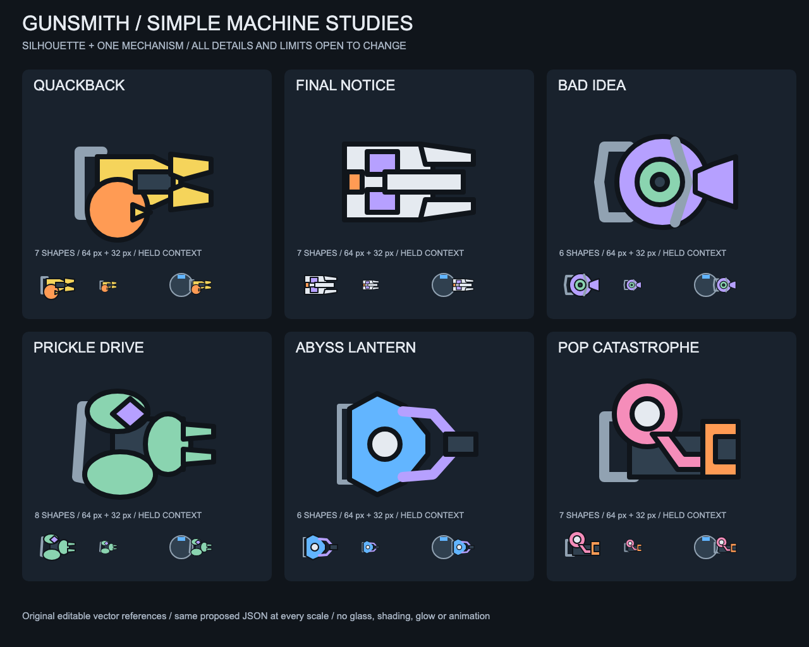

# Simple machine studies: a provisional build brief

2026-11-13, art. The user likes the richer concepts but asks for a simpler starting point, a clear explanation for
build, and AI evaluation of JSON generation/defaults. **Everything here is open to change:** silhouettes, palette,
shape vocabulary, coordinates, anchors, limits, defaults, renderer approach and scheduling. These are references for
joint design work, not a frozen contract or instructions to build ahead of the playable game.

[Editable sheet](SimpleMachines.svg) · [Grayscale](SimpleMachinesGrayscale.png) · [Six-shape lantern detail](LanternReference.png)

## What I kept, and why

The richer [six-weapon sheet](../improbable-machinery-03.md) and [three-weapon study](../overhead-machinery-02.md)
remain useful aspiration references. Their exaggerated masses, open gaps and visible working assemblies give the
weapons personality. This version keeps those relationships and removes glass, specular highlights, springs, bolts,
small vents and animation. It uses flat fills rather than making a shaded-material system a prerequisite.

Each concept has roughly three to five major groups, expressed with **six to eight drawing primitives**. A group is
an art idea, such as a chamber with an inset core; it can require more than one primitive. These counts describe these
examples, not a proposed universal production cap. All shapes are structural; no detail-tier field is needed to tell
this particular drawing what to omit. The existing proposed `detail` field remains explicit for compatibility.

The design goal is a recognisable machine at actual held size. The smaller samples are deliberately demanding:
64/32 px standalone bodies and a held composition with the body further scaled by 0.65. Richer reveal art can be added
later if it can share the same identity. Actual playtesting, generation and profiling still need to prove this approach.

| Concept / appearance-only JSON | Retained identity | Simplification |
| --- | --- | --- |
| [Quackback](QuackbackAppearance.json) | Split beak, offset round chamber, open brace | Solid hopper with one beak cue; plain breech instead of a spring |
| [Final Notice](FinalNoticeAppearance.json) | Broad office casing, paired rollers, paper path | Two roller blocks and one paper strip; no buttons or print |
| [Bad Idea](BadIdeaAppearance.json) | Round vessel, crescent handle, spout | Solid mint core, one band; no glass, lid or reflective orb |
| [Prickle Drive](PrickleDriveAppearance.json) | Staggered lobes, crown, forward comb | Three solid oval pods, one diamond; no ribs or tiny spikes |
| [Abyss Lantern](AbyssLanternAppearance.json) | Wide bell, core, converging conduits | One bell polygon, one core circle, two open ribbons and a socket |
| [Pop Catastrophe](PopCatastropheAppearance.json) | Offset hopper, routed gum, blunt collar | Solid inset disc and one ribbon; no balls, glass or roller detail |

These examples are not the entire visual catalogue. Prompt-defined proportions and combinations must still vary.
If a new silhouette needs an additional reusable shape, we can change the vocabulary after trying it.

## Concrete material for build

The six JSON files are complete **proposed appearance blocks**, using the earlier draft vocabulary. They contain no
weapon stats or behaviour definition. The current AI stat schema does not accept these fields; this delivery adds no
runtime/schema code. `SimpleMachines.svg` contains the exact body primitives from the files in array/layer order.
[Measurements](measurements.json) record parts, points and pretty-printed UTF-8 bytes, not model output token costs.

- Design space: 64 × 64, right-facing. Colours resolve through palette roles. Each circle/ellipse uses centre x/y;
  a rectangle uses upper-left x/y; points in supplied polygons/polylines are absolute with x/y zero. Rotation is zero.
- Reuse the existing proposed field meanings in [the first-pass dictionary](../top-down-oddities/README.md).
  Stroke colours can use palette roles too. This study proposes a fixed `outline` role (`#10151B`) and a lighter
  `body` fill (`#30404F`) so the breech stays visible on the slate sheet; palette adoption remains open. Conduit
  strokes are 4 design pixels, other outlines 2. Round joins/caps
  keep the shapes compact. Real open gaps reveal the arena surface; they are not painted background patches.
- Preview grip `(12,32)` and muzzle `(60,32)` remain provisional. Held views use the previous translate `(29,11.2)`
  and scale `0.65`. Build must reconcile art placement with authoritative firing geometry rather than copy numbers
  into physics. Generated decoration does not change firing origin, collider, vision, ammo or damage.
- The JSON has no projectile drawing, only a neutral impact preset and no animation. Empty projectile arrays mean
  this study supplies **no projectile override**; they never imply a beam or select gameplay. Behaviour still comes
  from separate validated gameplay data. The silhouette's several prongs do not determine pellet count.

Suggested first implementation experiment, **when the game needs generated visuals**:

1. Acceptance-test first, load hand-authored examples through one generic, validated composition renderer. Start with
   the six-shape lantern, then test the contrasting fax and kettle. No special cases keyed to these weapon names.
2. Compare 64/32 px, actual held size, four aim directions, both team markings and arena surfaces. Keep team/fog
   overlays renderer-owned. Confirm changing appearance leaves gameplay/visibility unchanged.
3. Measure draw calls/frame time, part counts, bytes and compilation/cache behaviour. These static SVGs do not prove
   a particular WebGL performance budget. Compile once rather than rebuilding compositions every frame.
4. Let AI's measured failures inform vocabulary/default changes before moving anything into a shared contract. Keep
   test-first constraints and the current game-first milestone order. Review this brief, not just the pretty pictures.

## AI evaluation and defaults: user-requested work

The task is explicitly recorded in `TODO-ai.md`. Local candidate-schema experiments can inform the design before M2;
this does not authorise a premature shared schema, paid calls or runtime image generation. The intended match-time
path is model-produced bounded JSON interpreted by fixed code. Image generation was used only for earlier references.

Evaluate whether low-level parts, a smaller semantic recipe with code-supplied geometry, or a bounded hybrid produces
usable variation at acceptable cost. The six fixtures demonstrate possible drawing data; they do not prove that the
model can reliably invent it. Do not settle this architecture from these examples alone.

Candidate defaults to examine together, **not decisions already made**:

| Situation | Candidate to evaluate | Failure to guard against |
| --- | --- | --- |
| Appearance omitted | Code supplies a modest neutral composition for the supported behaviour | Invisible weapon or every result becoming visually identical |
| Palette/material omitted | Bounded deterministic palette/flat fill from code | Unreadable contrast, team-confusing tint, unnecessary generated detail |
| Pose/detail/animation omitted | Right-facing canonical pose, no fine decoration or animation | Ambiguous aim or silently expanding output size |
| Invalid geometry/unknown fields/version | Code validates; one bounded repair or explicit visual substitution policy | Silent loss of prompt identity or unbounded repair loops |
| Visual repair fails but gameplay is valid | Discuss a disclosed visual fallback while preserving validated gameplay | Replacing stats to solve an art failure, or claiming full prompt fulfilment |
| Unsupported requested effect | Explain supported interpretation or use the agreed rejection path | A cosmetic vortex being mistaken for real attraction |

Test underspecified prompts as seriously as detailed ones. Record identity/readability with human review initially,
separately from deterministic schema/bounds/anchor checks. Track complete usable outcomes, missing fields, repair and
fallback frequency, bytes/tokens, latency and model calls across repeated trials. Include omitted blocks, partial
blocks, malformed/excessive geometry, unknown roles and conflicting descriptions. Preserve real failures as eval cases
and prove the corresponding checks fail when enforcement is removed.

**Visual defaults do not decide the still-open gameplay-stat omission policy.** Build and AI must agree any stat
policy with the user separately. Keep explicit supported choices where possible; defaults should complete an idea,
not invent penalties or erase its defining silhouette.

## Status, provenance and limitations

All earlier references are retained. Two image-generation attempts for a simpler sheet were rejected by the tool;
this delivered alternative is original local vector geometry with six matching proposed JSON compositions. No
third-party artwork, new dependencies, runtime edits, schema changes, balance changes or manifest keys were added.
PNG previews are Chromium renders of the editable SVG. The lantern detail is another view of the same six-part body.

This is a workable starting point to test, not evidence that the final game must use this exact detail level.

Verification: six JSON bodies match their editable SVG groups exactly; the six-part lantern detail matches the same
JSON. All coordinates are finite, stroke-inclusive bounds fit the 64-space, IDs/references/local links resolve, and
five invalid-data probes are rejected. Colour/grayscale and the actual-size/held samples were inspected; graphite
contrast was increased after the first review. These are static art checks, not a performance or model-quality result.
Selected workspace checks passed (shared, engine, webapp, AI, acceptance DSL): lint, formatting, strict typecheck,
492 engine, 101 webapp and 67 AI tests. Unchanged audio was not rendered again; no gameplay acceptance or model evals
were run for this art-only delivery. No AI evaluation TODO is marked complete by these checks.
