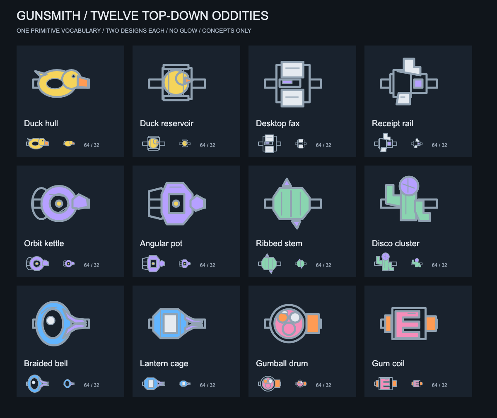

# Top-down oddities: twelve declarative compositions

Art delivery, 2026-11-12. Two designs per prompt, following the user's approved plan and permission to explore yellow/pink accents.
These are original editable vector studies, not production sprites or an implemented weapon contract.

[Editable overview](overview.svg) · [Grayscale](overview-grayscale.png) · [Held rotations](held-review.png) · [Pickups](pickup-review.png)

Each of the six sheets contains two enlarged overhead designs, 64 px and 32 px body samples, held standing/crouched
samples, and projectile/impact motifs. Enlargement adds no geometry. Held frames are 96 × 64 design pixels, with the
weapon reduced to 0.65; a 32 px body sample therefore shows more weapon detail than a weapon held by a 32 px player.
The last two columns of the held review show that harder case. No glow is used anywhere.

| Prompt family | Sheet / editable source | Proposed behaviour, absent from today's schema |
| --- | --- | --- |
| Duck | [PNG](duck.png) / [SVG](duck.svg) | Bounded ricochet count and reflection rules |
| Fax | [PNG](fax.png) / [SVG](fax.svg) | Pellet count/spread and ammunition/damage accounting |
| Teapot | [PNG](teapot.png) / [SVG](teapot.svg) | Explosion radius, falloff and wall occlusion |
| Cactus | [PNG](cactus.png) / [SVG](cactus.svg) | Needle-shaped pellets under shotgun rules |
| Jellyfish | [PNG](jellyfish.png) / [SVG](jellyfish.svg) | Beam hit, duration and firing rules |
| Bubblegum | [PNG](bubblegum.png) / [SVG](bubblegum.svg) | Explosive bubbles; no sticky terrain |

Original player prompts and mechanics exclusions remain in [the profile-study brief](../prompt-built-oddities.md).

## How a generic renderer reproduces the drawings

The twelve files in `appearances/` are **appearance-only proposals**. They must not be submitted to the current AI
weapon validator. The fixtures deliberately contain no weapon stats, generated code, URLs or weapon-name instructions.
Their filenames identify examples for humans; rendering never branches on those names.

1. Parse the versioned appearance and validate its primitive arrays before rendering. These examples propose two new
   fields in addition to the earlier visual proposal: `palette` and per-part `detail`.
2. Resolve colour roles from the palette below. Process `body` in array order, back to front, in a 64 × 64 space.
   Positive x is forward. Background, player, team stripes, pickup diamond and fog remain outside these arrays.
3. Draw every structural part at 64 px and 32 px. Draw fine parts only when the standalone body is displayed at least
   64 px wide; the held preview uses the parent 64/32 source-detail tier before its additional 0.65 reduction.
   The final renderer may choose a stricter screen-size threshold after playtesting. Never remove a structural part.
4. For held views, map the fixed local grip `(12,32)` to the renderer's hand, preserving proportions. These preview
   sheets use translation `(29,11.2)` followed by body scale `0.65`; the neutral player's centre is `(20,32)`.
   Rotate the complete held group around that player centre. Standing radius 18 and crouched radius 13 are visual only.
   Team shoulder stripes draw last: one blue band or two orange bands. They remain visible in the rotation sheet.
5. The proposed fixed visual muzzle is `(60,32)`. Backends keep the authoritative firing origin; decorative spouts and
   multiple barrels do not relocate it or create additional shots. For pickups use the identical body array at scale
   1 or 0.5, with a separate neutral diamond through `(32,-7)`, `(71,32)`, `(32,71)`, `(-7,32)`.
6. Draw `projectile` in its own 64-space, centred on `(32,32)`, with runtime size and collision owned by build.
   Empty projectile arrays on the jellyfish variants mean the illustrative fixed beam line supplies the shot geometry.
   Actual beam availability must come from gameplay data, never this empty array or the weapon's name.
7. `impact` selects a known decorative preset and role colour. The sheets illustrate a ring or radial spark/burst/pop
   motif; they are still-frame direction studies, not specified animation timing. `animation` is `none` in every fixture.
   Engine events trigger effects only when visible; art cannot expose hidden players or create damage areas.

### Primitive field dictionary

Every part has `kind`, `x`, `y`, `fill`, `stroke`, `strokeWidth`, `opacity`, `rotation` and `detail`.
`detail` is `structural` or `fine`. Opacity is 1 and rotation is 0 in this deliberately small fixture subset.
`x/y` mean centre for circles/ellipses and upper-left for rectangles; polygon/polyline points are local to x/y
(all supplied point arrays use x/y zero). Future nonzero rotation is in degrees around x/y, validated after transform.

| Kind | Additional geometry | Drawing rule |
| --- | --- | --- |
| `circle` | `radius` | Closed filled circle |
| `ellipse` | `radiusX`, `radiusY` | Closed filled ellipse |
| `rect` | `width`, `height` | Square-corner rectangle |
| `polygon` | `points`: ordered coordinate pairs | Close last point to first |
| `polyline` | `points`: ordered coordinate pairs | Open stroke; these fixtures use transparent fill |

Stroke widths are 2 for structural parts and 1 for fine parts at 64 px; normal scaling makes a 2 px stroke 1 px at 32 px.
Stroke joins/caps are round. SVG paths in the presentation frames are not part of the generated shape vocabulary.
The same conventions apply to projectiles. No part requires nested groups, an SVG path string, shader or custom font.

### Palette mapping

`palette` maps `accent` and `accent-secondary` to bounded token names; it never accepts an arbitrary CSS string.
`body`, `edge`, `text` and `none` are fixed roles. This is an art proposal, not a change to Tailwind tokens.

| Role / token | Colour |
| --- | --- |
| body | `#18212B` |
| edge | `#91A2B2` |
| text | `#E5EAF0` |
| none | Transparent fill/stroke |
| weapon-blue | `#62B5FF` |
| weapon-orange | `#FF9B54` |
| weapon-violet | `#B6A0FF` |
| weapon-mint | `#8AD4B0` |
| weapon-yellow, proposed | `#F5D45B` |
| weapon-pink, proposed | `#F58DBA` |

Yellow/pink are user-authorised concept experiments; final adoption belongs to M2. The shape of the team stripe,
pickup diamond and ring chevrons distinguishes ownership, objects and danger even when their colours are similar.

## Identity and variation rules

The following are reusable shape relationships for generation, not a fixed catalogue or name-to-sprite lookup.
A duck request can combine a toy hull, beak and tail in many arrangements; these two examples are not its only forms.
At 32 px, favour the outer contour and one defining internal feature. Tiny eyes, paper rules and cage braces may disappear.

### duck-hull

[Appearance JSON](appearances/duck-hull.json). Broad toy hull, rear tail and forward beak survive reduction.

Vary hull width and beak length; keep the beak on the aim axis. Bounded ricochets; duck shots cannot pass through walls.

### duck-reservoir

[Appearance JSON](appearances/duck-reservoir.json). Square cage contrasts with the round duck visible inside it.

Change cage proportions and brace spacing, not the muzzle location. Same proposed ricochet behaviour as the hull; cage is decorative.

### fax-desktop

[Appearance JSON](appearances/fax-desktop.json). Block casing, pale feeder and output tray read as an office appliance from above.

Vary tray length and casing width; keep paper layers distinct from the firing socket. Pellet count and spread need explicit shotgun rules; paper is pellet decoration.

### fax-receipt

[Appearance JSON](appearances/fax-receipt.json). Long thin casing and folded receipt ribbon produce a different top silhouette.

Vary ribbon folds and rail length; no readable invoice text. Same proposed shotgun behaviour; more paper graphics do not imply more pellets.

### teapot-kettle

[Appearance JSON](appearances/teapot-kettle.json). Loop handle on the rear, circular lid and spout on the front define the kettle.

Vary pot diameter and handle width while retaining an open handle hole. Explosive interpretation only; no attraction, absorption or teleportation.

### teapot-angular

[Appearance JSON](appearances/teapot-angular.json). Faceted overhead vessel and angular handle replace the round kettle.

Vary corner cuts and lid proportions; avoid relying on implied height. Same proposed explosion; orbit markings are cosmetic.

### cactus-stem

[Appearance JSON](appearances/cactus-stem.json). Ribbed succulent body and two large spine facets stay legible overhead.

Change rib spacing and body length; keep tiny spines in the fine tier. Needle shotgun; no poison or omnidirectional damage.

### cactus-cluster

[Appearance JSON](appearances/cactus-cluster.json). Offset arms create a branching silhouette; a faceted crown carries the disco cue.

Vary arm lengths and crown facets inside the same bounds. Same proposed shotgun; decorative side arms do not fire independently.

### jellyfish-bell

[Appearance JSON](appearances/jellyfish-bell.json). Broad bell and paired tapering braids converge toward the fixed front socket.

Vary bell width and braid bends; retain a clear forward convergence. Beam requires engine support; tentacles neither track nor grant vision.

### jellyfish-cage

[Appearance JSON](appearances/jellyfish-cage.json). Narrow polygon cage and luminous core distinguish this lantern from the soft bell.

Vary cage facets and brace spacing, keeping braids directed forward. Same proposed beam; fixed line geometry belongs to the renderer.

### gum-drum

[Appearance JSON](appearances/gum-drum.json). Round hopper with large gumballs contrasts with a wide dispenser muzzle.

Vary ball arrangement and hopper size; balls are decoration, not ammunition counts. Explosive bubble interpretation; no sticky floors, slowing or trapping.

### gum-coil

[Appearance JSON](appearances/gum-coil.json). Rectangular reservoir and folded gum strip make an angular alternative to the drum.

Vary fold count and reservoir ratio while retaining gaps of at least 2 design pixels. Same proposed explosion; folds do not create extra shots.

## What the schema review found

Inspected the actual AI worktree, including uncommitted eval restructuring, rather than main's older AI package.
The pipeline source was at `e1dffc0` on `worktree-ai-hosting-proof`; eval folders were being reorganised during review.
The reviewed `WeaponDraft` has `name`, `bulletDamage`, `fireIntervalSeconds`, `bulletSpeed`, `magazineSize`,
`reloadSeconds` and `startingReserve`. It has no appearance, palette, behaviour, sound or vision block.

A local, model-free schema probe accepted the reference weapon and confirmed that its loose structured reply can keep
extra `appearance`/`behaviour` fields, but strict validation rejects both. Generation and repair currently ask only
for the name and six stats. A successful shotgun or shield eval proves creation/caps/path checks, not spread or reflection.
The shield limitation remains an engine request; it is not disguised as another cosmetic preset here.

Build/AI requests:

- Review `palette` role assignments, `detail` tiers and fixed anchors before adopting this proposal. Keep validation
  strict and structured replies repairable; do not paste these examples into the current stat schema and silently lose them.
- Separate gameplay validation from visual failure policy. The earlier proposed visual-only fallback is not what today's
  pipeline does: today an invalid whole weapon is repaired once, then returns `invalid` if still invalid.
- Extend actual behaviour contracts when gameplay needs ricochets, spread, explosions and beams. No default balances,
  pellet counts or damage numbers are invented by this art delivery. Reflective shields need their own gameplay work.
- Reproduce these twelve fixtures using one renderer, then measure identity retention, draw cost, structured-output
  size and repair rate. Do not add a bespoke renderer for each named example. Static shape support alone proves no model
  can generate good compositions; model identity evals remain AI-owned and unperformed here.

## Budgets and review

[Measurements](measurements.json) count all body/projectile points and the UTF-8 bytes of each appearance file,
including whitespace. This excludes a future complete weapon envelope, prompt and response accounting.

| Design | Body / projectile parts | Points | JSON bytes |
| --- | --- | --- | --- |
| duck-hull | 8 / 3 | 10 | 3365 |
| duck-reservoir | 10 / 3 | 10 | 3852 |
| fax-desktop | 9 / 3 | 12 | 3668 |
| fax-receipt | 8 / 3 | 21 | 3854 |
| teapot-kettle | 8 / 3 | 13 | 3449 |
| teapot-angular | 8 / 3 | 25 | 4029 |
| cactus-stem | 8 / 1 | 24 | 3533 |
| cactus-cluster | 9 / 1 | 23 | 3709 |
| jellyfish-bell | 8 / 0 | 17 | 2990 |
| jellyfish-cage | 8 / 0 | 24 | 3309 |
| gum-drum | 9 / 2 | 0 | 2856 |
| gum-coil | 7 / 2 | 14 | 3096 |

All fit the initial proposal: 24 body parts, 8 projectile parts, 32 points per part, 384 total points and 12 KiB.
Point/primitive bounds include half the stroke width, not just centres. Every supplied transform is the identity;
future rotated or animated parts still need transformed, stroke-inclusive bounds checks on every frame.

Visual review covers colour/grayscale, glow off, both source-detail tiers, pickup markers and four cardinal held aims.
The cactus's central rib was promoted to structural detail after the first reduced-size review. The four-aim sheet
was corrected to rotate around the player's centre. Identity is strongest in standalone/reveal views; cage braces,
duck eyes and paper rules intentionally disappear in small held views. In-game readability still needs playtesting.

No runtime files, final asset keys, dependencies, model calls or game mechanics were introduced. SVGs are editable
sources; PNGs are Chromium renders of those sources. The JSON and SVG bodies were compared structurally using a
scratch validator, which also rejected oversized counts, unknown kinds, nonfinite numbers and overflowing geometry.
The temporary authoring/render tools are not runtime dependencies. Legal provenance: original local vector geometry;
no sampled art or image-model call was used for these new studies.

Final verification: `pnpm checks` exited 0: lint, formatting, strict typecheck and all available unit tests passed
(492 engine, 101 webapp, 67 AI and 3 audio; shared/acceptance DSL report no unit tests). The audio integration test
rendered/decoded all cues twice and took about 20 minutes. Browser gameplay acceptance and model evals were not run
for this art/docs-only delivery. `git diff --check` and local Markdown-link checks also pass.
