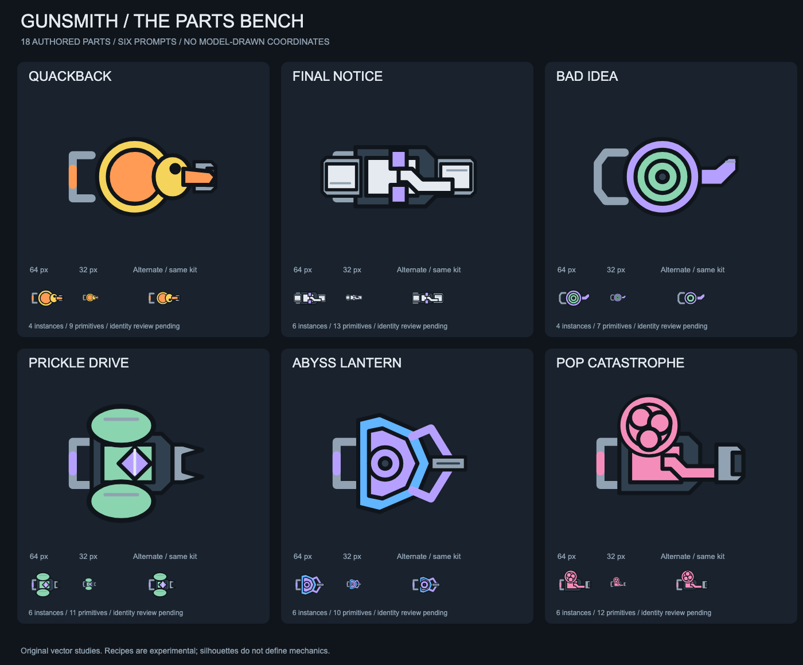

# Weapon parts kit 05

2026-11-13, art. **Experimental art handoff, not a production contract.**
The user chose flat, clear silhouettes and a few bounded assembly choices.
Eighteen authored pieces supply all twelve assemblies below: one primary and
one alternate for each original oddity prompt. No model drew these examples.

[Editable sheet](KitAssemblies.svg) · [Grayscale](KitAssembliesGrayscale.png) ·
[Parts catalogue](PartsCatalogue.png) · [Held rotations](HeldReview.png) ·
[Smaller held review](SmallHeldReview.png)

## What to review

The enlarged drawings expose construction; the 64/32 px samples expose how much
survives. Held weapons are reduced again to 0.65 of their design size. The smaller
held review halves the entire held sheet, including player and weapon. View PNGs
at 100% for actual pixel size. Stripes remain one blue / two orange, drawn last.
These sheets do not simulate fog or establish a runtime scale.

| Prompt / primary recipe | Identity cues | Art's remaining reservations |
| --- | --- | --- |
| [Duck cannon](recipes/quackback.json) | Head, eye and protruding beak; round toy reservoir | Eye loses importance at held size; ricochet identity needs supported shot effects |
| [Office fax](recipes/final-notice.json) | Two pale trays, paper ribbon and paired rollers | Can read as a printer or conveyor; no text, controls or recognisable fax handset |
| [Black-hole teapot](recipes/bad-idea.json) | Open rear handle, round vessel and rising spout | Lens also reads as a machine core; black-hole identity needs separate supported effects |
| [Disco cactus](recipes/prickle-drive.json) | Paired green pods, faceted crown and needle comb | More mechanical than botanical; disco and tiny spines weaken at 32 px |
| [Jellyfish lantern](recipes/abyss-lantern.json) | Wide bell, inset core and conduits converging toward emitter | Angular cage rather than soft jellyfish; no translucency or hanging tentacles |
| [Bubblegum mortar](recipes/pop-catastrophe.json) | Bubble hopper, routed ribbon and broad collar | Contents distinguish it mostly at larger sizes; no bubble projectile supplied |

**User visual approval (2026-11-14): “looks really good”.** This is the approved
starting point for the next AI selection/placement comparison. The reservations
above remain useful probe targets; approval of authored examples does not prove
model output quality. The sheets’ “identity review pending” labels reflect their
pre-approval generation. See the [original prompts](../prompt-built-oddities.md)
for complete wording and gameplay exclusions.

## Files and ownership

- [Parts.json](Parts.json) is the authored library: anchors, parameter choices,
  palette and 1–3 primitives per piece. `parts/` holds matching editable 64-space
  previews, with the local attachment origin shifted to `(32,32)`.
- `recipes/` holds twelve compact-in-meaning selection/attachment examples.
  Each `*-alternate.json` reuses the catalogue, changes the body's size and may
  change a lens/crown size, tray size or mirroring. No extra geometry is added.
- `assemblies/` holds expanded drawing JSON and matching 64 × 64 SVGs. These are
  reference drawings, **not** current AI appearance-schema payloads.
- [Assembly.md](Assembly.md) defines the provisional interpretation precisely.
  [Measurements.json](Measurements.json) counts instances, expanded primitives,
  points and compact UTF-8 bytes. Bytes are not model tokens or generation cost.
- [Verification.json](Verification.json) records deterministic QA and negative
  controls. Original artwork; PNGs are Chromium renders of these SVGs. No external
  resources, third-party art, image generation, paid call or dependency was used.

Build owns runtime interpretation and manifest keys. AI owns the next model probe,
its structured reply schema and the choice to compare kit, primitive or hybrid
arms. This kit provides data and examples; it adds no production API or renderer.

## What this kit cannot say

| Request beyond the kit | Proposed handling for owner review |
| --- | --- |
| Snake, violin, shoe, creature anatomy or an arbitrary recognisable object | Record an unsupported identity. Offer a disclosed mechanical approximation, or author a reusable new part after review; do not claim exact fulfilment |
| Smooth soft jellyfish, glass vessel, intricate springs, organic motion | Current kit offers angular solid shells and static conduits. Rich materials/animation need a separate measured extension |
| Full reflective shield silhouette | Not represented. Needs a reviewed visual part and build's actual directional shield behaviour |
| Gravity, sticky floors, poison, homing tentacles, extra pellets from extra barrels | Appearance cannot supply these mechanics. Use separately supported gameplay or explain the limitation |
| A combination that exceeds the canvas or obscures its defining feature | Refuse that assembly in the experiment. Change a supported selection/size; no silent clipping, geometry pruning or stat changes |

No universal prompt classifier or production fallback policy is implemented here.
The proposals above leave rejection, repair, disclosure and call budgets to the
owners. Visual defaults do not settle the open gameplay-stat omission policy.

## Findings for AI and build

The six primaries use 4–6 instances and 7–13 expanded primitives. All twelve fit
inside the strict stroke-inclusive canvas and the AI draft's 24-body-part budget;
there is no reason to raise that cap for these examples. Per-part sizes do **not**
make every possible combination legal. Validate the final assembly. Details belong
to the pieces; the model need not repeat stroke/opacity/detail on every primitive.

The newer AI worktree report now records Haiku's user verdict, “way better,
already nearly usable”, and a later 36-drawing run with 33 first answers valid,
one repaired and two lantern stand-ins. This is AI's reported result, not rerun
by art. The old local probe's 1/72 strict-valid and 59/72 stand-ins remain local-tier
results. The kit is a comparison candidate, not proof it beats Haiku's primitive
output. Long tentacles remain a useful failure case for the bounded kit arm.

Probe selection/placement with the original prompts and sparse, unsupported and
conflicting requests. Measure identity, validity, variation, output tokens, latency,
repair and disclosed substitutions separately. Prompt size includes the catalogue
description as well as the example; smaller output alone does not prove lower cost.
No generation or gameplay acceptance suite was run for this art delivery.

## Verification (2026-11-14)

All twelve expanded drawings match their SVG primitives, pass stroke-inclusive
bounds and pass AI's current draft validator through the temporary adapter
specified in `Assembly.md`. Nine faulty examples in
[RejectedRecipes.json](RejectedRecipes.json) are rejected. Numeric anchor/grip
checks, SVG safety/reference checks, artifact hashes and local links pass.
Colour, grayscale, catalogue and both held sizes were visually inspected.
Recipe output is 752–1116 compact UTF-8 bytes; expanded reference drawings are
1106–2084 bytes. These exclude the catalogue supplied to a model.

Final root `pnpm checks` exits 0: lint, formatting, strict typecheck and unit tests
(516 engine, 152 AI, 127 webapp, 253 audio passed / one slow render check skipped).
Earlier attempts hit audio lint/format issues being fixed concurrently by build;
the subsequent local-server test required running outside the sandbox.
No audio file or tool was changed for this kit. Gameplay acceptance, full audio
re-render and appearance model-selection evals were not run for this delivery.

Verification used temporary local authoring/QA scripts; they are not shipped as
a production interpreter. `Parts.json`, the recipes and `Assembly.md` are the
reproduction inputs, with expanded JSON/SVGs as exact expected outputs.
